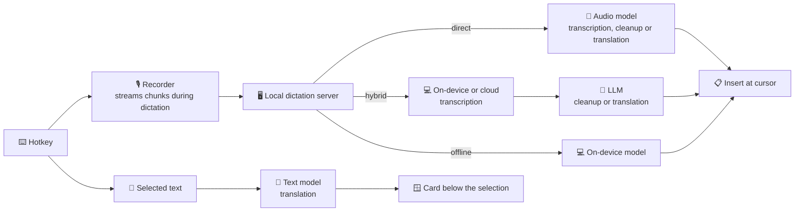

<p align="center">
  
</p>

<h1 align="center">SpeakMore</h1>

<p align="center">
  <b>Speak it written. Select to translate.</b><br>
  Free, open-source voice input and translation for macOS and Windows.<br>
  Voice input, voice translation and selection translation, each one hotkey away in any app.<br>
  Works with leading AI models; voice input can also run entirely on device.<br>
  <a href="https://speakmore.zephyrxiang.com">speakmore.zephyrxiang.com</a>
</p>

<p align="center">
  
  
  
  <a href="LICENSE"></a>
</p>

<p align="center">
  <a href="README.md">简体中文</a> · <b>English</b>
</p>

<picture>
  <source media="(prefers-color-scheme: dark)" srcset="https://media.speakmore.zephyrxiang.com/readme/home-dark.en.2cec7117.webp" />
  
</picture>

## Three features

All three start from Right ⌥ (Right Alt on Windows): on its own for voice input, with Space for voice translation, with Return for selection translation.

| Feature | What it does | macOS | Windows |
| --- | --- | --- | --- |
| 🎙️ **[Voice input](#️-voice-input)** | Dictate; the text is cleaned up and inserted at the cursor | Right ⌥ | Right Alt |
| 🌐 **[Voice translation](#-voice-translation)** | Speak one language, write another | Right ⌥ + Space | Right Alt + Space |
| 📖 **[Selection translation](#-selection-translation)** | Select any text; the translation appears below it | Right ⌥ + Return | Right Alt + Enter |

### 🎙️ Voice input

<picture>
  <source media="(prefers-color-scheme: dark)" srcset="https://media.speakmore.zephyrxiang.com/readme/dictate-dark.en.9365162e.webp" />
  
</picture>

- Press the hotkey to start dictating; press it again to insert the text at the cursor.
- Filler words, repetitions and self-corrections are removed (Direct and Hybrid modes).
- Punctuation is added; longer passages are split into paragraphs and lists.
- Names, products and terms in the dictionary are spelled as written there.
- Three recognition modes of equal standing; Offline mode runs entirely on device and uploads nothing.

### 🌐 Voice translation

<picture>
  <source media="(prefers-color-scheme: dark)" srcset="https://media.speakmore.zephyrxiang.com/readme/translate-dark.en.04741ca4.webp" />
  
</picture>

- Speak in English and the text arrives in Chinese; 16 target languages are available.
- Suited to group chats with colleagues and clients abroad, and to emails and commit messages in another language: the translation goes straight into the input box, with no separate translation tool.
- Speech is cleaned up before translation, so fillers and self-corrections stay out; history keeps both the original and the translation.
- Set target languages in Settings › Voice translation; several can be listed, and the first is the default. Switch the target on the voice bar while speaking; the choice applies to that dictation only.
- Median model time: 2.6 seconds with Direct, 1.3 seconds with Hybrid.
- Works in Direct and Hybrid modes; the on-device models of Offline mode only transcribe, so it offers no voice translation.

### 📖 Selection translation


<table>
  <tr>
    <td width="50%"></td>
    <td width="50%"></td>
  </tr>
  <tr>
    <td align="center"><sub>Terminal</sub></td>
    <td align="center"><sub>Notes</sub></td>
  </tr>
</table>

- Select text in any app and press Right ⌥ + Return; the translation appears in a card just below the selection.
- No plug-ins to install and no app restrictions: web pages, PDFs, terminals, documents and chat apps all work.
- The card never takes focus, so the app being read or edited stays as it was; it offers copy, a one-off change of target language, and pinning.
- When the text is already in the target language, it is translated into English instead (into Simplified Chinese when the target is English); the card shows the language actually used.
- Uses its own text model, independent of voice: DeepSeek V4.1 Flash by default, about 0.9 seconds per request; change it in the Selection section of the Engine page, including OpenAI-compatible services.
- Translations are kept in history and counted in spending, but not in the dictation statistics on the home window.

## Five freedoms

- 🧩 **[Model freedom](#-model-freedom)**: 29 voice models, plus a separate text model for selection translation; refinement and selection translation both accept OpenAI-compatible services.
- 🔀 **[Mode freedom](#-mode-freedom)**: three recognition modes for voice input and voice translation; recommended setups in one click.
- 💻 **[Hardware freedom](#-hardware-freedom)**: Mac and Windows; on-device models on Metal, Vulkan or the CPU.
- 🔒 **[Privacy freedom](#-privacy-freedom)**: voice input can run fully offline, with no uploads, API key or account.
- 💸 **[Cost freedom](#-cost-freedom)**: free software; at 100 uses a day, recommended voice setups cost $0–5.29 a month and selection translation about $0.36.

## 🚀 Installation

<p align="center">
  <a href="https://dl.zephyrxiang.com/speakmore/v0.18.1/SpeakMore-arm64.dmg"></a>
  <a href="https://dl.zephyrxiang.com/speakmore/v0.18.1/SpeakMore-x64.dmg"></a>
  <a href="https://dl.zephyrxiang.com/speakmore/v0.18.1/SpeakMore-Setup-x64.exe"></a>
</p>

**macOS**

- Requires macOS 12 or later.
- Open the dmg and drag SpeakMore into Applications.
- Signed with a Developer ID and notarized by Apple.

**Windows**

- Requires Windows 10 (1809 or later) or Windows 11, 64-bit.
- Run the installer; if "Windows protected your PC" appears, select **More info**, then **Run anyway**.
- Installs per user, without administrator rights.
- No network connection is needed during installation.

**Terminal installation** (includes the `speakmore` command-line tool)

```bash
# macOS
curl -fsSL https://dl.zephyrxiang.com/speakmore/install.sh | bash
```

```powershell
# Windows (PowerShell)
irm https://dl.zephyrxiang.com/speakmore/install.ps1 | iex
```

- Append `.sha256` to any download link to obtain its checksum.

**Storage location**

- The program, on-device models, settings, history and recordings are kept in one folder, by default `~/.speakmore` (`%USERPROFILE%\.speakmore` on Windows).
- A different place, such as another disk, can be chosen on first install: the Mac app asks when it first opens, the Windows installer asks before installing, and the terminal installation asks in the terminal. SpeakMore is kept in `.speakmore` inside the chosen folder.
- To change it later, use Settings › General › Storage location, or run `speakmore move <folder>`; everything is moved together and SpeakMore reopens when done.
- The disk must be formatted as APFS, Mac OS Extended or NTFS; exFAT and FAT32 USB sticks and external drives are not supported.

<details>
<summary><b>Installer and terminal installation compared</b></summary>

- The installer provides a standalone app; macOS permissions are granted to SpeakMore itself, and it can open at login.
- The terminal installation on macOS runs from the terminal; permissions are granted to that terminal.
- On Windows, both methods install the same files into `%USERPROFILE%\.speakmore` and add a Start menu entry.
- Both share settings, history and the `speakmore` command; run only one at a time.

</details>

## 🧭 Usage

SpeakMore resides in the menu bar (the notification area on Windows). All three features are triggered by hotkeys and work in any app, without opening the main window.

### Voice input

1. Place the cursor in any text field and press **Right ⌥** (**Right Alt** on Windows).
2. Dictate. The bar at the bottom of the screen follows the input level and shows the keys that finish and cancel.
3. Press the hotkey again to insert the cleaned-up text at the cursor, or press `esc` to discard the dictation.

Press once to start and once to finish; there is no need to hold the key.

### Voice translation

1. Place the cursor in a text field and press **Right ⌥ + Space** (**Right Alt + Space** on Windows).
2. Speak. The voice bar shows this dictation's target language; click it to switch for this time only.
3. Press Right ⌥ + Space again to insert the translation at the cursor, or press `esc` to discard it.

### Selection translation

1. Select some text in any app, up to 4,000 characters at a time.
2. Press **Right ⌥ + Return** (**Right Alt + Enter** on Windows); a card with the translation appears below the selection.
3. The card offers copy, a one-off change of target language, and pinning. Press `esc` or click anywhere outside the card to dismiss it; a pinned card stays when you click elsewhere.

On macOS, reading the selected text requires Accessibility permission, which onboarding turns on along with the others.

### Main window

Open the main window from the menu bar icon. The four pages are on the left, with settings at the bottom left.

| Page | Contents |
| --- | --- |
| Home | The hotkeys of the three features, the active recognition mode, words dictated and speaking rate, a daily heatmap, and the spending trend |
| Engine | Models, keys and recommended setups for the Voice and Selection sections; see [Model freedom](#-model-freedom) |
| History | Every record from the three features, filterable by feature, searchable by text, and exportable to Markdown / JSON / CSV; translations show the original; each entry can be copied, replayed, or rerun with another model |
| Dictionary | Names, products and terms that voice input and voice translation spell as written there |

<table>
  <tr>
    <td width="50%"></td>
    <td width="50%"></td>
  </tr>
  <tr>
    <td align="center"><sub>History of the three features, with originals</sub></td>
    <td align="center"><sub>Dictionary: spelled as written</sub></td>
  </tr>
</table>

**Dictionary**

- Add the names, products and terms you say often, and voice input and voice translation spell them as written; selection translation does not use the dictionary.
- Import a one-column CSV or a one-word-per-line text file; existing words are skipped.
- The dictionary is stored on this device only and sent with each request to the chosen model; in Offline mode it never leaves the device. The dictionary page lists the models that support it.

### Settings

| Pane | Contents |
| --- | --- |
| General | Theme, interface language, launch at login, storage location, software update |
| Shortcut | Hotkeys for the three features and for cancel; key hints on the voice bar |
| Voice translation | Target languages; several can be listed, and the first is the default |
| Selection translation | Target language |
| On-device models | Download source, acceleration, memory release |
| Permissions | Status of microphone, Input Monitoring and Accessibility (Mac only) |
| About | Version and source code |

- To change a hotkey, click it and press a new key or two-key combination; it applies at once. Each feature takes up to 4 combinations, and the selection translation hotkey can be cleared.
- Combinations that clash with system or common shortcuts can't be bound; the rules are under Reference › Settings below.

<table>
  <tr>
    <td width="50%"></td>
    <td width="50%"></td>
  </tr>
  <tr>
    <td align="center"><sub>Settings › Shortcut</sub></td>
    <td align="center"><sub>Settings › Voice translation</sub></td>
  </tr>
</table>

### Onboarding

- On first launch, onboarding demonstrates the three features, checks the hotkeys, turns on system permissions (Mac only), and ends on the Engine page to set up models.
- Onboarding asks for no API key and downloads no model: both are done on the Engine page, where a recommended setup is enabled in one click.
- Every step can be revisited or skipped; hotkeys, permissions and the engine can be changed in the main window at any time.

<table>
  <tr>
    <td width="50%"></td>
    <td width="50%"></td>
  </tr>
  <tr>
    <td align="center"><sub>Splash</sub></td>
    <td align="center"><sub><b>1</b> · The three features</sub></td>
  </tr>
  <tr>
    <td></td>
    <td></td>
  </tr>
  <tr>
    <td align="center"><sub><b>2</b> · Check the hotkeys</sub></td>
    <td align="center"><sub><b>3</b> · Permissions (Mac only)</sub></td>
  </tr>
  <tr>
    <td></td>
    <td></td>
  </tr>
  <tr>
    <td align="center"><sub><b>4</b> · Open Engine</sub></td>
    <td align="center"><sub>Recommended setups in one click</sub></td>
  </tr>
</table>

## 🧩 Model freedom

<picture>
  <source media="(prefers-color-scheme: dark)" srcset="https://media.speakmore.zephyrxiang.com/readme/vendors-dark.en.2ca87638.webp" />
  
</picture>

<sub>All names and logos are the property of their respective owners and are shown solely to indicate supported services.</sub>

The **Engine** page has two sections: voice input and voice translation share the models of the Voice section, while selection translation uses the text model chosen in the Selection section.

**Voice** lays out modes, steps, vendors and models as a tree:

- **7 Direct models**: audio in, text out; for voice translation they write the target language directly.
- **10 Transcribe models**: 4 on-device, 6 cloud.
- **12 Refine models**: Qwen, DeepSeek, Kimi, Zhipu, MiniMax, and custom services; for voice translation this step does the translating.
- Open a model to see its list prices, measured scores and channels; the route in use is highlighted.
- A model offered by several platforms appears once, with its channel chosen in the details.

**Selection** picks a single text model of its own, from the same vendors as Refine; the two are configured independently. DeepSeek V4.1 Flash is the default.

**API keys** are managed per platform, in a panel at the top right; a platform's key serves all three features:

- One Alibaba Cloud Bailian key provides access to 14 models, across Direct, Transcribe, Refine and Selection.
- Official DeepSeek, Kimi, Zhipu, MiniMax, Gemini and OpenAI keys are supported directly.
- OpenAI-compatible services connect with an endpoint address and a key; voice and selection translation each have their own custom service.

<table>
  <tr>
    <td width="50%"></td>
    <td width="50%"></td>
  </tr>
  <tr>
    <td align="center"><sub>Voice: Refine model details</sub></td>
    <td align="center"><sub>Selection: its own text model</sub></td>
  </tr>
  <tr>
    <td colspan="2"></td>
  </tr>
  <tr>
    <td colspan="2" align="center"><sub>Keys managed per platform</sub></td>
  </tr>
</table>

## 🔀 Mode freedom

- Voice input and voice translation have three recognition modes of equal standing; selection translation is unaffected by the mode.
- Each mode keeps its own model configuration; switching requires no reconfiguration.
- Switch in the first column of the Engine page; the home window shows the active mode to the right of the title.

| Mode | Pipeline | Data uploaded | API key | Voice input | Voice translation |
| --- | --- | --- | --- | --- | --- |
| ✨ **Direct** | Audio → audio model → text | Recording | Required | ✓ | ✓ |
| 🪄 **Hybrid** | Audio → transcription → LLM refinement or translation | Text only, if transcribed on device | Required | ✓ | ✓ |
| 🛡️ **Offline** | Audio → on-device model → text | None | None | ✓ | — |

<sub>The on-device models in Offline mode only transcribe, so it offers no voice translation. Selection translation always uses the text model chosen in the Selection section of the Engine page.</sub>

<table>
  <tr>
    <td width="50%"></td>
    <td width="50%"></td>
  </tr>
  <tr>
    <td align="center"><sub>Switching modes on the Engine page</sub></td>
    <td align="center"><sub>Recommended setups</sub></td>
  </tr>
</table>

**Recommended setups**:

- Package a complete voice pipeline, enabled in one click.
- Can be checked before they are enabled.
- Missing keys and on-device models are completed in place.

| Setup | Mode | Pipeline | Monthly cost |
| --- | --- | --- | --- |
| On-device + DeepSeek | Hybrid | Qwen3-ASR 0.6B (on device) → DeepSeek V4.1 Flash | **$0.39** |
| Bailian Cloud | Hybrid | Qwen3 ASR Flash → DeepSeek V4.1 Flash | $3.02 |
| Gemini | Direct | Gemini 3.6 Flash | $5.29 |
| Fully On-device | Offline | Qwen3-ASR 0.6B (on device) | **$0** |

<sub>Monthly cost is estimated for voice input: 100 dictations a day for 30 days; 26 seconds per dictation (the average of 97 real dictations); at vendor list prices. Intel Macs use the CPU build of SenseVoice Small.</sub>

## 💻 Hardware freedom

- On-device models handle the transcription step: voice input in Offline mode, and transcription for both voice input and voice translation in Hybrid mode, can run on this machine.
- The same on-device models run on every supported device.
- An available graphics card is used first.
- Without a usable graphics card, SpeakMore falls back to the CPU automatically.

| Device | Acceleration | Model | Per dictation |
| --- | --- | --- | --- |
| Mac, Apple silicon | Metal | Qwen3-ASR 0.6B | **231 ms** |
| Windows + GPU | Vulkan | Qwen3-ASR 0.6B | **240 ms** |
| Mac, Apple silicon | CPU | SenseVoice Small | 145 ms |
| Windows (i5-13400F) | CPU | SenseVoice Small | 463 ms |

<sub>Median transcription time across 97 real dictations; Windows GPU: RTX 4060 Ti. Vulkan supports NVIDIA, AMD and Intel graphics.</sub>


## 🔒 Privacy freedom

- **Fully offline voice input**: in Offline mode, speech is transcribed by an on-device model and nothing is uploaded.
- **No API key in Offline mode**; no account in any mode.
- **Translation sends only what it needs**: voice and selection translation call the selected model; the former sends the recording or its transcript, the latter only the selected text.
- **One-click download**: on-device models are served from ModelScope, a mirror in mainland China.
- **Automatic fallback**: Hugging Face is used if the mirror is unavailable; interrupted downloads resume where they stopped.
- **Integrity check**: every download is verified against SHA-256.
- **No intermediary servers**: audio or text goes directly to the selected vendor with the user's own key.
- **No analytics.**
- **Encrypted keys**: protected by the macOS Keychain or Windows DPAPI.
- **Local data**: history, recordings and the dictionary remain on the local machine.

<picture>
  <source media="(prefers-color-scheme: dark)" srcset="https://media.speakmore.zephyrxiang.com/readme/download-speed-dark.en.abab8fdd.webp" />
  
</picture>

## 💸 Cost freedom

- SpeakMore is free.
- Model usage is billed directly by each vendor, according to actual use.
- The home window tracks spending for today, this month and all time: bars and a trend line show the course, with each model's cost and share below; all three features are included.

| Feature | Setup | Per use | Monthly at 100 a day |
| --- | --- | --- | --- |
| Voice input | On-device + DeepSeek | about $0.00013 | $0.39 |
| Voice translation | On-device + DeepSeek | about $0.00008 | about $0.23 |
| Selection translation | DeepSeek V4.1 Flash | about $0.00012 | about $0.36 |

<sub>Voice input is estimated on the basis of the recommended setups above; voice translation and selection translation are medians of real requests (8 and 15 respectively), at list prices.</sub>


Voice input compared with every Typeless plan (heavy use, 100 dictations a day):

<table>
  <tr>
    <th>Product</th><th>Plan</th><th>Monthly</th><th>Annual</th><th>Words</th><th>Voice data</th><th>Sign-up</th>
  </tr>
  <tr>
    <td rowspan="4">Typeless</td><td>Free</td><td>$0</td><td>$0</td><td>Capped</td><td>Typeless<sup>1</sup></td><td>Yes</td>
  </tr>
  <tr>
    <td>Pro, annual</td><td>$12</td><td>$144</td><td>Unlimited</td><td>Typeless<sup>1</sup></td><td>Yes</td>
  </tr>
  <tr>
    <td>Pro, monthly</td><td>$30</td><td>$360</td><td>Unlimited</td><td>Typeless<sup>1</sup></td><td>Yes</td>
  </tr>
  <tr>
    <td>Enterprise</td><td>Quote</td><td>Quote</td><td>Unlimited</td><td>Typeless<sup>1</sup></td><td>Yes</td>
  </tr>
  <tr>
    <td rowspan="4"><b>SpeakMore</b></td><td><b>Fully On-device</b></td><td><b>$0</b></td><td><b>$0</b></td><td>Unlimited</td><td><b>On device</b></td><td><b>No</b></td>
  </tr>
  <tr>
    <td><b>On-device + DeepSeek</b></td><td><b>$0.39</b></td><td><b>$4.70</b></td><td>Unlimited</td><td>DeepSeek</td><td><b>No</b></td>
  </tr>
  <tr>
    <td><b>Bailian Cloud</b></td><td><b>$3.02</b></td><td><b>$36</b></td><td>Unlimited</td><td>Alibaba Cloud</td><td><b>No</b></td>
  </tr>
  <tr>
    <td><b>Gemini</b></td><td><b>$5.29</b></td><td><b>$63</b></td><td>Unlimited</td><td>Google</td><td><b>No</b></td>
  </tr>
</table>

<sub>With On-device + DeepSeek, only the transcribed text is sent to DeepSeek. Typeless prices from <a href="https://www.typeless.com/pricing">typeless.com/pricing</a> (2026-10-17). SpeakMore figures are estimates on the basis of the setups table above; usage within Gemini's free tier incurs no cost.<br>
<sup>1</sup> Sent to Typeless servers together with the active application, window title and on-screen text; see the <a href="targets/typeless/docs/06-context-capture-and-privacy.md">reverse-engineering notes</a> (Chinese).</sub>

## 📊 Benchmarks

- **Voice input**: the prompt was tuned on 60 real recordings, each compared with the Typeless output for the same audio; 97 real dictations (42.5 minutes, covering Chinese, mixed Chinese–English and English) are scored 0–5 against the Direct mode output, using a fixed rubric.
- **Voice translation**: 20 real recordings translated into English and Japanese, with no formatting errors in either Direct or Hybrid mode; median model time 2.6 seconds in Direct mode, 1.3 seconds in Hybrid.
- **Selection translation**: 18 sentences, two runs each (English to Chinese, Chinese to English, already in the target language, Traditional Chinese, single words, error messages, lists, Japanese, French); DeepSeek V4.1 Flash chose the right target language 36 out of 36 times, with a median of 0.87 seconds per request.

<details>
<summary><b>On-device transcription: Apple silicon and Windows</b></summary>

| Model | Score | Size | Mac | Windows |
| --- | --- | --- | --- | --- |
| `qwen3-asr-0.6b-q8` (default) | 4.14–4.16 | 850 MB | Metal 231 ms | Vulkan 240 ms |
| `sensevoice-small-q8` | 3.94 | 253 MB | Metal 73 ms | Vulkan 107 ms |
| `qwen3-asr-0.6b-int8` | 4.02–4.06 | 987 MB | CPU 1081 ms | CPU 3388 ms |
| `sensevoice-small-int8` | 3.75–3.78 | 237 MB | CPU 145 ms | CPU 463 ms |

- Times are medians per dictation.
- Windows test machine: Core i5-13400F, RTX 4060 Ti.
- Scores by language: Qwen3-ASR 4.32 on Chinese, 4.02 on mixed Chinese–English; SenseVoice 4.38 on Chinese.
- Full results: [Apple silicon](bench/results/asr-round1-2026-10-16.md), [Windows](bench/results/asr-windows-2026-10-17.md) (Chinese).

</details>

<details>
<summary><b>End to end: Hybrid mode on Apple silicon</b></summary>

- From hotkey release to text on screen: **1.2–1.75 seconds**.
- Transcription takes under 0.7 seconds; the remainder is the refinement request.
- With prompt caching, one DeepSeek refinement request costs about $0.00004.
- See the [measurements](bench/results/e2e-local-2026-10-16.md) (Chinese).

</details>

- The benchmark harness resides in [`bench/`](bench/README.md); adding a model runs only that model's column. Voice translation and selection translation are evaluated with `scripts/dev/eval-translate.mjs` and `scripts/dev/eval-lookup.mjs`; results are in the [implementation notes](docs/implementation-notes.md) (Chinese).

## ✅ Trust

- **Open source**: MIT-licensed; all code for the three features is public.
- **No account**: no registration or sign-in.
- **Single directory**: data, settings, keys, models and logs are stored in one folder, by default `~/.speakmore` (`%USERPROFILE%\.speakmore` on Windows), which can be moved to another disk.
- **Complete removal**: `speakmore uninstall` deletes everything.
- **Signed and notarized**: the Mac app carries a Developer ID signature and Apple notarization.
- **Verifiable**: every package has a SHA-256 checksum.
- **Reverse-engineered**: the Typeless client is documented in [18 notes](targets/typeless/docs/00-overview.md) (Chinese).
- **Independently implemented**: SpeakMore was written from scratch and contains no Typeless code or keys.

## 🧑‍💻 For developers

- **CLI and app parity**: switch modes and models, manage and check keys, download models, query history and spending.
- **JSON output**: `status`, `history` and `usage` support `--json`. In `status --json` the hotkeys are `hotkey.dictate`, `hotkey.translate`, `hotkey.lookup` and `hotkey.cancel` (under both `status` and `settings`, as set), with the combinations in effect under `status.hotkeysInEffect`.
- **Plug-in architecture**: each vendor is a strategy behind a common interface; voice input, voice translation and selection translation are separate and share only low-level mechanisms such as checks and keys.
- **Unified I/O**: audio is normalized to 16 kHz mono; every transcriber returns `{ text }`.
- **Cross-platform development**: [`scripts/dev/win-*.sh`](scripts/dev) synchronize the working tree to a Windows machine over SSH, run tests remotely, restart the app from source with a debugging port, and capture the desktop.
- **Automated tests**: 1500 unit tests and 54 installation tests.
- **Quality gates**: Biome linting plus checks on interface sizing, typography and copy; `npm run check` runs them all.

```bash
git clone https://github.com/zephyr4123/speakmore.git && cd speakmore
npm install
npm start          # equivalent to the speakmore command
npm run check      # lint and all tests
```



- Project layout, packaging and release process: [development notes](docs/development.md) (Chinese).
- Mapping to the original, model selection and prompt tuning: [implementation notes](docs/implementation-notes.md) (Chinese).

## 📚 Reference

<details>
<summary><b>⌨️ Commands</b></summary>

| Command | Description |
| --- | --- |
| `speakmore` | Start; shows status if already running |
| `speakmore stop` / `restart` | Stop / restart |
| `speakmore status [--json]` | Running state, keys, permissions and usage |
| `speakmore update` | Update to the latest version |
| `speakmore history [-n count] [--json]` | History, including voice and selection translations, newest first |
| `speakmore usage [--json]` | Spending, tokens and response times per model |
| `speakmore dict [--json]` | Show the dictionary |
| `speakmore dict add` / `remove <word>…` | Add / remove words |
| `speakmore dict import <file>` | Import a one-column CSV or a one-word-per-line text file; existing words are skipped |
| `speakmore mode [native\|local\|private]` | Show or switch the recognition mode |
| `speakmore model [<provider>[/<model>]]` | Show or switch the Direct model |
| `speakmore transcriber [<model>]` | Show or switch the Transcribe model |
| `speakmore transcriber download <model>` | Download an on-device model |
| `speakmore transcriber cancel <model>` | Cancel a download |
| `speakmore transcriber delete <model>` | Delete an on-device model |
| `speakmore polish [<provider>/<model>]` | Show or switch the Refine model |
| `speakmore model check` | Check the Direct model |
| `speakmore transcriber check` | Check the Transcribe model |
| `speakmore polish check` | Check the Refine model |
| `speakmore key [<provider>]` | Replace a key; accepts piped input |
| `speakmore key --forget [<provider>]` | Delete a stored key |
| `speakmore config` / `config set` / `config unset` | Show settings / set a value / restore the default |
| `speakmore theme [name]` | Show or switch the theme |
| `speakmore settings` | Open settings |
| `speakmore logs [-n lines] [-f]` | Show logs |
| `speakmore move [<folder>]` | Move everything into `.speakmore` inside the folder (`~` is the default place); without a folder, show the current place |
| `speakmore uninstall [--keep-data]` | Uninstall, after confirmation |

- `update` also updates SpeakMore.app; settings, keys, history, recordings and the dictionary are preserved.
- `check` commands send a minimal request (for on-device models, a sentence read by the system voice) to check connectivity and response time.
- `native` is Direct, `local` is Hybrid, `private` is Offline.
- Direct providers: `gemini` / `openai` / `bailian`.
- Refine providers: `deepseek` / `bailian` / `moonshot` / `zhipu` / `minimax` / `custom`; a custom service also takes `--url <url>`, and optionally `--params '<JSON>'` for extra request parameters.
- Voice translation targets: `config set translate.to`; the selection translation model and target: `config set lookup.model`, `config set lookup.to`, or the Engine page and Settings in the app.
- Piped input example: `pbpaste | speakmore key` (Windows: `Get-Clipboard | speakmore key`).

</details>

<details>
<summary><b>⚙️ Settings</b></summary>

| Name | Default | Description |
| --- | --- | --- |
| `hotkey.dictate` | `["AltRight"]` | Hotkey for voice input |
| `hotkey.translate` | `["AltRight+Space"]` | Hotkey for voice translation |
| `hotkey.lookup` | `["AltRight+Enter"]` | Hotkey for selection translation; can be cleared |
| `hotkey.cancel` | `["Escape"]` | Hotkey that discards a dictation in progress or dismisses the selection card |
| `mode` | `native` | Recognition mode: `native` (Direct) / `local` (Hybrid) / `private` (Offline) |
| `model` | `gemini/gemini-3.6-flash` | Direct model, as `provider/model` |
| `thinking` | `MINIMAL` | Gemini thinking level |
| `transcriber` | `qwen3-asr-0.6b-q8` | Transcribe model for Hybrid mode |
| `privateTranscriber` | `qwen3-asr-0.6b-q8` | On-device model for Offline mode |
| `polish` | `deepseek/deepseek-flash` | Refine model, as `provider/model` |
| `customUrl` | empty | OpenAI-compatible endpoint for refinement |
| `customParams` | empty | Extra request parameters for the refinement custom service, as a JSON object |
| `translate.to` | `["en"]` | Voice translation targets; the first is the default |
| `lookup.to` | `zh-CN` | Selection translation target |
| `lookup.model` | `deepseek/deepseek-flash` | Selection translation model, as `provider/model` |
| `lookup.customUrl` | empty | OpenAI-compatible endpoint for selection translation |
| `lookup.customParams` | empty | Extra request parameters for the selection translation custom service, as a JSON object |
| `modelSource` | `cn` | Download source: `cn` / `original` |
| `acceleration` | `auto` | Acceleration: `auto` / `cpu` |
| `localModelMemory` | `resident` | On-device transcription model memory: `resident` / `1m` / `5m` / `10m` / `30m` |
| `barHint` | `on` | Hint line above the voice bar: `on` / `off` |
| `livePreview` | `on` | Preview words on the voice bar while speaking (on-device recognition only, last few seconds): `on` / `off` |
| `outputScript` | `simplified` | Script of dictated Chinese: `simplified` / `traditional-hk` / `traditional-tw` |
| `theme` | `ink` | Theme: `ink` / `cinnabar` / `indigo` |
| `language` | `system` | Language: `system` / `en` / `zh-CN` / `zh-TW` |

- Settings are stored in `~/.speakmore/settings.json`.
- A hotkey value is a list of combinations. Keys use [`KeyboardEvent.code`](https://developer.mozilla.org/docs/Web/API/UI_Events/Keyboard_event_code_values) names (e.g. `AltRight`, `MetaRight`, `ControlRight`, `Fn`, `Space`, `Enter`, `KeyK`, `F13`), with two keys joined by `+`. A single combination can be written as is: `speakmore config set hotkey.dictate ControlRight+F9`; several go in a JSON array: `'["AltRight","ControlRight"]'`.
- A combination has at most two keys; cancel takes a single non-modifier key. Combinations that clash with system or common shortcuts can't be bound (⌘ or ⌃ with a letter, the Windows key, and on Windows Left Alt + Space and Left Alt + Enter), nor can combinations of left-hand modifiers only, or Shift or Caps Lock on its own.
- Target languages are language codes such as `en`, `ja` and `zh-CN`; `translate.to` takes several: `speakmore config set translate.to en,ja`.
- A `hotkey` setting from 0.13 or earlier is converted on upgrade; the old form, such as `config set hotkey right_command`, still works.
- Gemini thinking levels: `MINIMAL` / `LOW` / `MEDIUM` / `HIGH`.
- On a machine short of memory, set `localModelMemory` to release the transcription model after 1, 5, 10, or 30 idle minutes (Settings › On-device models › Memory). The model loads when you start speaking, while you talk; it stays loaded through recording and refinement and is released once idle that long. The default keeps it in memory.
- Dictated text comes out simplified by default; pick Traditional in Settings › General › Output script (`outputScript`): `traditional-hk` uses Hong Kong forms, `traditional-tw` uses Taiwan forms. English, numbers, and Cantonese-only characters (嘅, 佢, 咗) are the same in both scripts and stay untouched.
- A self-hosted refinement model is written as `custom/<model>`, e.g. at `http://127.0.0.1:11434/v1`; selection translation works the same way through `lookup.model` and `lookup.customUrl`.
- Extra parameters a custom service needs go in `customParams` (`lookup.customParams` for selection translation), e.g. `{"reasoning_effort": "minimal"}`. They are sent with both checks and requests; `model`, `messages`, and `stream` cannot be overridden. When capping a reasoning model's output, leave room for its thinking (e.g. `{"max_completion_tokens": 4096}`), or long passages get cut off.
- A local Ollama or LM Studio can also release its model when idle, set through `customParams`: `{"keep_alive": "5m"}` for Ollama (0.35 or newer), `{"ttl": 300}` (seconds) for LM Studio.
- In Windows PowerShell, put a backslash before each double quote in `--params`: `--params '{\"reasoning_effort\": \"minimal\"}'`.
- Switching through the app or `speakmore mode`, `model`, `transcriber` and `polish` is checked first and takes effect immediately.
- `config set` writes values directly, without checks.
- Temporary overrides: set environment variables such as `SPEAKMORE_HOTKEY_DICTATE`, `SPEAKMORE_HOTKEY_TRANSLATE`, `SPEAKMORE_HOTKEY_LOOKUP`, `SPEAKMORE_HOTKEY_CANCEL`, `SPEAKMORE_MODE`, `SPEAKMORE_MODEL`, `SPEAKMORE_TRANSLATE_TO` and `SPEAKMORE_LOOKUP_MODEL` at startup. Hotkeys are written as in the settings file; the old `SPEAKMORE_HOTKEY` means `SPEAKMORE_HOTKEY_DICTATE`.
- Keys in environment variables take precedence over stored keys: `GEMINI_API_KEY`, `OPENAI_API_KEY`, `DEEPSEEK_API_KEY`, `BAILIAN_API_KEY`, `MOONSHOT_API_KEY` (Kimi), `ZHIPU_API_KEY`, `MINIMAX_API_KEY`, `SPEAKMORE_CUSTOM_API_KEY`, `SPEAKMORE_LOOKUP_CUSTOM_API_KEY` (the selection translation custom service).

</details>

<details>
<summary><b>💰 Cost accounting</b></summary>

- Every model call is recorded with its tokens (including audio and thinking), model, cost and latency; voice translation and selection translation are included.
- The home window shows the spending trend and each model's share for today, this month and all time; hover a bar for its breakdown.
- On-device transcription appears as a separate, free entry.
- `speakmore usage` provides further detail.
- Costs are estimates in US dollars at each vendor's list price; platforms priced in yuan are converted at 6.71.
- Gemini's prompt cache bills repeated prompt content at one tenth of the standard price; the cache is created as soon as dictation starts.

</details>

<details>
<summary><b>🔐 Permissions</b></summary>

| macOS permission | Purpose |
| --- | --- |
| Microphone | Recording (voice input, voice translation) |
| Input Monitoring | Detecting the hotkeys, responding only to those keys; reading the keys pressed while recording a hotkey |
| Accessibility | Inserting text with a simulated ⌘V; reading the selected text (selection translation); holding back `esc`, combination hotkeys and keys pressed while recording, so they don't reach the active app |

- The app requests these permissions during onboarding; once Input Monitoring is on, one press of the voice input hotkey confirms it works.
- With the terminal installation, permissions are granted to the terminal that runs SpeakMore.
- On Windows, only microphone access is required (Settings › Privacy & security › Microphone).

</details>

<details>
<summary><b>🗂️ File locations</b></summary>

| File | Description |
| --- | --- |
| `settings.json` | Settings |
| `vocabulary.json` | Dictionary |
| `<vendor>-key.bin` | Encrypted keys, one per vendor; the selection translation custom service has its own `lookupcustom-key.bin` |
| `data/history.db` | History and spending records (all three features) |
| `data/Recordings/` | Recordings |
| `logs/main.log` | Logs |
| `models/` | On-device models |
| `bin/`, `app/`, `runtime/` | Program files of the terminal installation |

- All files are stored in the storage location (by default `~/.speakmore/`, `%USERPROFILE%\.speakmore\` on Windows) and are readable only by the current user.
- The key decryption secret is held in the Keychain (bound to the account by DPAPI on Windows); a copied key file cannot be decrypted.
- Logs contain lengths, timings and usage only; dictated content, selected text and keys are never logged.
- On-device models are downloaded on request and verified against SHA-256.
- Outside this directory: the Keychain entry, granted system permissions, and SpeakMore in Applications.
- On Windows, also the Start menu shortcut, a Path entry and the open-at-login entry.
- When the storage location is not the default, a location file records it: `~/Library/Application Support/com.zephyrxiang.speakmore/location.json` (`%LOCALAPPDATA%\SpeakMore\location.json` on Windows).

</details>

<details>
<summary><b>🩺 Troubleshooting</b></summary>

| Symptom | Resolution |
| --- | --- |
| A key shows "not verified" | Run `speakmore status` once online |
| A check fails although the key is correct | Run `speakmore model check` to see the response |
| The hotkey has no effect | Run `speakmore status`, then `speakmore restart` |
| Voice translation says it isn't available in Offline mode | Switch to Direct or Hybrid on the Engine page |
| The selection card says "Select some text first" or "Couldn't read the selection" | Select the text and press again; on macOS, turn on Accessibility |
| The selection card says "No key set" | Click "Add key" on the card and enter the key for the chosen model |
| On macOS, some combination hotkeys stop working for a while | Another app has secure input on (a password field, or Secure Keyboard Entry in a terminal); they work again once it's off, and the voice bar says so |
| On Windows, the hotkey or selection translation doesn't work in some windows | That window runs as administrator, and Windows doesn't pass its keys or selection to other programs; the voice bar or card says so |
| A command times out | Run `speakmore stop`, then `speakmore` |
| No menu bar icon | Run `speakmore settings` |
| SpeakMore's folder can't be found | If the storage location is on an external drive, connect it first |

- "Not verified" means the vendor was unreachable at startup and the stored key is in use.
- A failed check is usually caused by an incorrect model name or thinking level; `speakmore config unset model` restores the default.
- On MacBooks with a notch, surplus menu bar icons are hidden behind it; hold ⌘ and drag some icons out of the menu bar.

</details>

<details>
<summary><b>🔄 Updating and uninstalling</b></summary>

- **Update**: in the app, Settings › General › Software update checks for and installs new versions; `speakmore update` in a terminal does the same. Both use one update process: download and verify in the background first, then replace the terminal installation and SpeakMore.app, and reopen whichever was running. SpeakMore stops only while the files are being replaced. Updates download only what changed, usually a few MB.
- **0.10.1 and earlier**: these versions cannot detect later releases; reinstall once. On a Mac, download the new dmg and install it over the existing copy, or run the terminal install command again; on Windows, run the installer or the install command again.
- **Preserved on update**: settings, keys, history, recordings and the dictionary.
- **Downgrading to 0.11.0 or earlier**: older versions only know the default place; run `speakmore move ~` first to move back to it.
- **Uninstall**: `speakmore uninstall` stops SpeakMore and removes the entire directory, the command, the location file and the Keychain entry.
- **Uninstall on Windows**: also removes the Path entry, Start menu shortcut and open-at-login entry.
- **Keep data**: add `--keep-data` to preserve settings, keys, history, recordings and the dictionary.
- **Uninstall, app only**: quit it from the menu bar and move it to the Trash.

</details>

## License

- [MIT](LICENSE).
- Files under `.claude/skills/` are from [REA](https://github.com/morluto/rea) and are covered by its own MIT license.
- The three avatars in the onboarding demo (`src/renderer/onboarding/avatars/`) are free stock photos: [Pexels 7705905](https://www.pexels.com/photo/7705905/) (ShotPot), [Pexels 3936894](https://www.pexels.com/photo/3936894/) (Татьяна Танатова) and [Unsplash 0-LBoX_pAiA](https://unsplash.com/photos/0-LBoX_pAiA) (Adi Probo), under the Pexels and Unsplash licenses.
- The name pays tribute to Typeless. SpeakMore is an independent implementation based on reverse-engineering notes and is not affiliated with Typeless.
