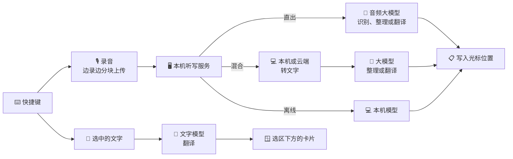

<p align="center">
  
</p>

<h1 align="center">SpeakMore</h1>

<p align="center">
  <b>口述成文，划词即译。</b><br>
  开源、免费的语音输入与翻译工具，支持 macOS 与 Windows。<br>
  语音输入、语音翻译、划词翻译，各由一个快捷键触发，在任意应用中可用。<br>
  兼容主流大模型，语音输入亦可完全在本机运行。<br>
  <a href="https://speakmore.zephyrxiang.com/?lang=zh-CN">speakmore.zephyrxiang.com</a>
</p>

<p align="center">
  
  
  
  <a href="LICENSE"></a>
</p>

<p align="center">
  <b>简体中文</b> · <a href="README.en.md">English</a>
</p>

<picture>
  <source media="(prefers-color-scheme: dark)" srcset="https://media.speakmore.zephyrxiang.com/readme/home-dark.zh-CN.596d6346.webp" />
  
</picture>

## 三项功能

三项功能均以右 ⌥（Windows 为右 Alt）为起点：单按为语音输入，加空格为语音翻译，加回车为划词翻译。

| 功能 | 用途 | macOS | Windows |
| --- | --- | --- | --- |
| 🎙️ **[语音输入](#️-语音输入)** | 口述，整理为通顺的文字后写入光标处 | 右 ⌥ | 右 Alt |
| 🌐 **[语音翻译](#-语音翻译)** | 说一种语言，直接写出另一种 | 右 ⌥ + 空格 | 右 Alt + 空格 |
| 📖 **[划词翻译](#-划词翻译)** | 选中任意文字，译文在选区下方显示 | 右 ⌥ + 回车 | 右 Alt + 回车 |

### 🎙️ 语音输入

<picture>
  <source media="(prefers-color-scheme: dark)" srcset="https://media.speakmore.zephyrxiang.com/readme/dictate-dark.zh-CN.8b70e026.webp" />
  
</picture>

- 按下快捷键开始口述，再次按下结束，文字写入当前光标位置。
- 自动去除语气词、重复与改口内容（直出、混合方式）。
- 自动补全标点，较长内容分段、分条。
- 词典中的专有名词、产品名与术语按词典的写法输出。
- 三种识别方式并列可选，离线方式完全在本机运行，不上传任何数据。

### 🌐 语音翻译

<picture>
  <source media="(prefers-color-scheme: dark)" srcset="https://media.speakmore.zephyrxiang.com/readme/translate-dark.zh-CN.55998031.webp" />
  
</picture>

- 用中文口述，写入的是英文；目标语言支持 16 种。
- 适用于在群聊中与外国同事、客户交流，以及撰写英文邮件与提交说明：译文直接写入输入框，无需另开翻译工具。
- 先整理再翻译：语气词与改口不进入译文，原文与译文均记入历史。
- 在「设置 › 语音翻译」中预设目标语言，可设多种，第一种为默认；口述时可在悬浮条上临时切换，仅对本次生效。
- 模型耗时中位数：直出 2.6 秒，混合 1.3 秒。
- 使用直出或混合方式；离线方式的本机模型只能转文字，不提供语音翻译。

### 📖 划词翻译


<table>
  <tr>
    <td width="50%"></td>
    <td width="50%"></td>
  </tr>
  <tr>
    <td align="center"><sub>PDF</sub></td>
    <td align="center"><sub>终端</sub></td>
  </tr>
</table>

- 在任意应用中选中文字，按下右 ⌥ + 回车，译文显示在选区下方的卡片中。
- 无需安装插件，不限应用：网页、PDF、终端、文档与聊天软件均适用。
- 卡片不抢占焦点，正在阅读或编辑的应用保持原状；卡片上可复制译文、临时切换目标语言、固定卡片。
- 原文已是目标语言时，改译为英文（目标为英文时改译为简体中文），卡片上标明实际译成的语言。
- 使用独立的文字模型，与语音互不影响：默认 DeepSeek V4.1 Flash，单次约 0.9 秒；可在引擎页的「划词」一段更换，亦支持 OpenAI 兼容服务。
- 划词记录计入历史与花费，不计入首页的口述统计。

## 五项自由

- 🧩 **[模型自由](#-模型自由)**：语音 29 个模型，划词翻译另选文字模型；整理与划词均可接入 OpenAI 兼容服务。
- 🔀 **[方式自由](#-方式自由)**：语音输入与语音翻译有三种识别方式，并列可选；推荐组合一键启用。
- 💻 **[硬件自由](#-硬件自由)**：Mac 与 Windows 通用；本机模型经 Metal、Vulkan 或 CPU 运行。
- 🔒 **[隐私自由](#-隐私自由)**：语音输入可完全离线，不上传数据，无需密钥与账号。
- 💸 **[费用自由](#-费用自由)**：软件免费；按每日 100 次计，语音输入推荐组合月成本 ¥0–35，划词翻译约 ¥2.4。

## 🚀 安装

<p align="center">
  <a href="https://dl.zephyrxiang.com/speakmore/v0.19.0/SpeakMore-arm64.dmg"></a>
  <a href="https://dl.zephyrxiang.com/speakmore/v0.19.0/SpeakMore-x64.dmg"></a>
  <a href="https://dl.zephyrxiang.com/speakmore/v0.19.0/SpeakMore-Setup-x64.exe"></a>
</p>

**macOS**

- 系统要求：macOS 12 及以上。
- 打开 dmg，将 SpeakMore 拖入"应用程序"。
- 安装包已使用 Developer ID 签名，并通过 Apple 公证。

**Windows**

- 系统要求：Windows 10（1809 及以上）或 Windows 11，64 位。
- 运行安装程序；如出现"Windows 已保护你的电脑"，依次点击"更多信息""仍要运行"。
- 仅为当前账户安装，无需管理员权限。
- 安装过程无需联网。

**终端安装**（附带 `speakmore` 命令行工具）

```bash
# macOS
curl -fsSL https://dl.zephyrxiang.com/speakmore/install.sh | bash
```

```powershell
# Windows（PowerShell）
irm https://dl.zephyrxiang.com/speakmore/install.ps1 | iex
```

- 下载链接末尾附加 `.sha256`，可获取对应文件的校验值。

**存储位置**

- 程序、本机模型、设置、历史记录与录音统一保存在一个文件夹中，默认为 `~/.speakmore`（Windows 为 `%USERPROFILE%\.speakmore`）。
- 首次安装时可另选位置，例如其他磁盘：Mac App 首次打开时询问，Windows 安装程序在安装前询问，终端安装在命令行中询问。SpeakMore 保存在所选文件夹中的 `.speakmore`。
- 之后可在「设置 › 通用 › 存储位置」更改，或执行 `speakmore move <文件夹>`；全部文件整体迁移，完成后自动重新打开。
- 所选磁盘需为 APFS、Mac OS 扩展或 NTFS 格式；exFAT、FAT32 格式的 U 盘与移动硬盘不支持。

<details>
<summary><b>安装包与终端安装的区别</b></summary>

- 安装包为独立应用：macOS 权限授予 SpeakMore 本身，支持开机自启。
- 终端安装在 macOS 上由终端启动，权限授予所用终端。
- Windows 下两种方式的安装内容相同，均位于 `%USERPROFILE%\.speakmore`，并添加开始菜单项。
- 两种方式共用设置、历史记录与 `speakmore` 命令，同一时间运行其一即可。

</details>

## 🧭 使用

SpeakMore 常驻菜单栏（Windows 为任务栏通知区域）。三项功能均由快捷键触发，在任意应用中可用，无需打开主窗口。

### 语音输入

1. 将光标置于任意输入框，按下**右 ⌥**（Windows 为**右 Alt**）。
2. 开始口述，屏幕底部的悬浮条随音量变化，并提示结束与取消的按键。
3. 再次按下快捷键，整理后的文字写入光标位置；按 `esc` 取消本次口述。

按一下开始、再按一下结束，不需要一直按住。

### 语音翻译

1. 将光标置于输入框，按下**右 ⌥ + 空格**（Windows 为**右 Alt + 空格**）。
2. 开始口述，悬浮条上显示本次的目标语言，点击可临时切换。
3. 再次按下右 ⌥ + 空格，译文写入光标位置；按 `esc` 取消。

### 划词翻译

1. 在任意应用中选中一段文字，单次至多 4000 字。
2. 按下**右 ⌥ + 回车**（Windows 为**右 Alt + 回车**），选区下方出现卡片，显示译文。
3. 卡片上可复制译文、临时切换目标语言或固定卡片；按 `esc` 或点击卡片以外的位置即收起，固定后点击别处不再收起。

macOS 上读取选中的文字需要辅助功能权限，首次引导中一并开启。

### 主窗口

从菜单栏图标打开主窗口，左侧为四个页面，左下角为设置。

| 页面 | 内容 |
| --- | --- |
| 首页 | 三项功能的快捷键、当前识别方式、口述字数与语速、每日热力图、花费走势 |
| 引擎 | 「语音」「划词」两段的模型、密钥与推荐组合，详见[模型自由](#-模型自由) |
| 历史 | 三项功能的全部记录，可按功能筛选、按文字搜索，可导出 Markdown / JSON / CSV；翻译记录附原文；单条可复制、播放录音、换模型重跑 |
| 词典 | 专有名词、产品名与术语，语音输入与语音翻译按词典的写法输出 |

<table>
  <tr>
    <td width="50%"></td>
    <td width="50%"></td>
  </tr>
  <tr>
    <td align="center"><sub>历史：三项功能的记录，翻译附原文</sub></td>
    <td align="center"><sub>词典：按词典的写法输出</sub></td>
  </tr>
</table>

**词典**

- 常说的专有名词、产品名与术语加入词典后，语音输入与语音翻译按词典的写法输出；划词翻译不使用词典。
- 支持从单列 CSV 或每行一词的文本导入，已有的词跳过。
- 词典仅保存在本机，随请求发送给所选模型；离线方式下不离开本机。支持词典的模型列于词典页。

### 设置

| 一栏 | 内容 |
| --- | --- |
| 通用 | 主题、界面语言、开机自启、存储位置、软件更新 |
| 快捷键 | 三项功能与取消的快捷键，悬浮条上的按键提示 |
| 语音翻译 | 目标语言，可设多种，第一种为默认 |
| 划词翻译 | 目标语言 |
| 本机模型 | 下载源、加速方式、内存释放 |
| 权限 | 麦克风、输入监控与辅助功能（仅 Mac）的状态 |
| 关于 | 版本与源代码 |

- 更换快捷键：点击后按下新的键或两键组合，即刻生效；每项功能至多绑定 4 个组合，划词翻译的快捷键可清空。
- 与系统或常用快捷键冲突的组合不可绑定，规则见下文「参考 › 设置项」。

<table>
  <tr>
    <td width="50%"></td>
    <td width="50%"></td>
  </tr>
  <tr>
    <td align="center"><sub>设置 › 快捷键</sub></td>
    <td align="center"><sub>设置 › 语音翻译</sub></td>
  </tr>
</table>

### 首次引导

- 首次启动时，引导依次演示三项功能、检查快捷键、开启系统权限（仅 Mac），最后前往引擎页配置模型。
- 引导中不填写密钥、不下载模型：这些在引擎页完成，推荐组合一键启用。
- 各步骤均可前进、后退或跳过；快捷键、权限与引擎随时可在主窗口中修改。

<table>
  <tr>
    <td width="50%"></td>
    <td width="50%"></td>
  </tr>
  <tr>
    <td align="center"><sub>开屏</sub></td>
    <td align="center"><sub><b>1</b> · 演示三项功能</sub></td>
  </tr>
  <tr>
    <td></td>
    <td></td>
  </tr>
  <tr>
    <td align="center"><sub><b>2</b> · 检查快捷键</sub></td>
    <td align="center"><sub><b>3</b> · 开启权限（仅 Mac）</sub></td>
  </tr>
  <tr>
    <td></td>
    <td></td>
  </tr>
  <tr>
    <td align="center"><sub><b>4</b> · 前往引擎</sub></td>
    <td align="center"><sub>推荐组合一键启用</sub></td>
  </tr>
</table>

## 🧩 模型自由

<picture>
  <source media="(prefers-color-scheme: dark)" srcset="https://media.speakmore.zephyrxiang.com/readme/vendors-dark.zh-CN.fe7d3f86.webp" />
  
</picture>

<sub>上述名称与标志归各自权利人所有，仅用于说明 SpeakMore 支持对接的服务。</sub>

**引擎页**分「语音」「划词」两段：语音输入与语音翻译共用「语音」一段的模型，划词翻译使用「划词」一段单独选择的文字模型。

**语音**一段把识别方式、步骤、厂商、型号排成一棵树：

- **直出 7 个**：音频输入，文字输出；语音翻译时直接输出目标语言。
- **转文字 10 个**：本机 4 个，云端 6 个。
- **整理 12 个**：通义千问、DeepSeek、Kimi、智谱、MiniMax 与自定义服务；语音翻译时由这一步完成翻译。
- 点开型号查看官方价格、实测得分与渠道，正在使用的一路以主题色标出。
- 同一模型由多个平台提供时合并为一项，在详情中切换渠道。

**划词**一段单独选择一个文字模型，可选厂商与整理一步相同，配置互不影响；出厂为 DeepSeek V4.1 Flash。

**密钥**在标题行右侧的面板中按平台管理，同一平台的密钥在三项功能间共用：

- 一把阿里云百炼密钥可调用 14 个模型，覆盖直出、转文字、整理与划词。
- DeepSeek、Kimi、智谱、MiniMax、Gemini、OpenAI 的官方密钥均可直接使用。
- OpenAI 兼容服务填写地址与密钥即可接入；语音与划词的自定义服务分别配置。

<table>
  <tr>
    <td width="50%"></td>
    <td width="50%"></td>
  </tr>
  <tr>
    <td align="center"><sub>语音：整理模型详情</sub></td>
    <td align="center"><sub>划词：单独选择文字模型</sub></td>
  </tr>
  <tr>
    <td colspan="2"></td>
  </tr>
  <tr>
    <td colspan="2" align="center"><sub>按平台管理密钥</sub></td>
  </tr>
</table>

## 🔀 方式自由

- 语音输入与语音翻译有三种识别方式，并列可选；划词翻译不受识别方式影响。
- 各方式独立保存模型配置，切换时无需重新设置。
- 在引擎页第一列切换，首页标题右侧显示当前方式。

| 方式 | 处理流程 | 上传内容 | 密钥 | 语音输入 | 语音翻译 |
| --- | --- | --- | --- | --- | --- |
| ✨ **直出** | 录音 → 音频大模型 → 文字 | 录音 | 需要 | ✓ | ✓ |
| 🪄 **混合** | 录音 → 转文字 → 大模型整理或翻译 | 本机转文字时仅文字 | 需要 | ✓ | ✓ |
| 🛡️ **离线** | 录音 → 本机模型 → 文字 | 无 | 不需要 | ✓ | — |

<sub>离线方式的本机模型只能转文字，不提供语音翻译。划词翻译始终使用引擎页「划词」一段所选的文字模型。</sub>

<table>
  <tr>
    <td width="50%"></td>
    <td width="50%"></td>
  </tr>
  <tr>
    <td align="center"><sub>在引擎页切换识别方式</sub></td>
    <td align="center"><sub>推荐组合一键启用</sub></td>
  </tr>
</table>

**推荐组合**：

- 将语音的完整路线打包，一键启用。
- 支持先检测、后启用。
- 缺少的密钥与本机模型可在原处补齐。

| 组合 | 方式 | 路线 | 月成本 |
| --- | --- | --- | --- |
| 本机 + DeepSeek | 混合 | Qwen3-ASR 0.6B（本机）→ DeepSeek V4.1 Flash | **¥2.63** |
| 百炼全云端 | 混合 | Qwen3 ASR Flash → DeepSeek V4.1 Flash | ¥20.24 |
| Gemini | 直出 | Gemini 3.6 Flash | ¥35.49 |
| 纯本机 | 离线 | Qwen3-ASR 0.6B（本机） | **¥0** |

<sub>月成本为语音输入的估算：每日 100 次、每月 30 天；单次按 26 秒计（97 条真实口述的平均值）；按各厂商官方价格估算，美元按 6.71 折算。Intel Mac 改用 CPU 版 SenseVoice Small。</sub>

## 💻 硬件自由

- 本机模型负责转文字一步：离线方式的语音输入，以及混合方式下语音输入与语音翻译的转文字，均可在本机完成。
- 同一本机模型适用于全部受支持的设备。
- 有可用显卡时优先使用显卡。
- 无显卡或显卡不可用时，自动回退至 CPU。

| 设备 | 加速 | 模型 | 单条耗时 |
| --- | --- | --- | --- |
| Apple 芯片 Mac | Metal | Qwen3-ASR 0.6B | **231 毫秒** |
| Windows + 显卡 | Vulkan | Qwen3-ASR 0.6B | **240 毫秒** |
| Apple 芯片 Mac | CPU | SenseVoice Small | 145 毫秒 |
| Windows（i5-13400F） | CPU | SenseVoice Small | 463 毫秒 |

<sub>单条耗时为 97 条真实口述的转文字耗时中位数；Windows 显卡为 RTX 4060 Ti。Vulkan 支持 NVIDIA、AMD 与 Intel 显卡。</sub>


## 🔒 隐私自由

- **语音输入可完全离线**：选择离线方式时，语音由本机模型转为文字，不上传任何数据。
- **离线方式无需密钥**；任何方式均无需注册账号。
- **翻译仅发送所需内容**：语音翻译与划词翻译需调用所选模型，前者发送录音或转出的文字，后者仅发送选中的文字。
- **国内源一键下载**：默认经魔搭（ModelScope）下载本机模型。
- **自动切换下载源**：国内源不可用时改用 Hugging Face；中断后从断点续传。
- **完整性校验**：下载完成后校验 SHA-256。
- **无中转服务器**：录音或文字以用户自有密钥直接发送至所选厂商。
- **不采集统计数据**。
- **密钥加密存储**：macOS 使用钥匙串，Windows 使用 DPAPI。
- **数据留存本机**：历史记录、录音与词典仅保存在本机。

<picture>
  <source media="(prefers-color-scheme: dark)" srcset="https://media.speakmore.zephyrxiang.com/readme/download-speed-dark.zh-CN.42b8405b.webp" />
  
</picture>

## 💸 费用自由

- SpeakMore 本身免费。
- 模型费用按实际用量，直接结算给厂商。
- 首页按今天、本月、累计统计花费：柱状图与趋势线看走势，下方列出各模型的花费与占比；三项功能一并计入。

| 功能 | 配置 | 单次 | 每日 100 次的月成本 |
| --- | --- | --- | --- |
| 语音输入 | 本机 + DeepSeek | 约 ¥0.0009 | ¥2.63 |
| 语音翻译 | 本机 + DeepSeek | 约 ¥0.0005 | 约 ¥1.6 |
| 划词翻译 | DeepSeek V4.1 Flash | 约 ¥0.0008 | 约 ¥2.4 |

<sub>语音输入按上文推荐组合的口径估算；语音翻译、划词翻译为实际调用的中位数（分别为 8 次、15 次），按官方价格计，美元按 6.71 折算。</sub>


语音输入与 Typeless 各档套餐对比（重度使用，每日 100 次）：

<table>
  <tr>
    <th>产品</th><th>方案</th><th>月费</th><th>年费</th><th>字数</th><th>数据去向</th><th>账号</th>
  </tr>
  <tr>
    <td rowspan="4">Typeless</td><td>免费版</td><td>¥0</td><td>¥0</td><td>每周限额</td><td>Typeless 服务器<sup>1</sup></td><td>需注册</td>
  </tr>
  <tr>
    <td>Pro 年付</td><td>¥81</td><td>¥966</td><td>不限</td><td>Typeless 服务器<sup>1</sup></td><td>需注册</td>
  </tr>
  <tr>
    <td>Pro 月付</td><td>¥201</td><td>¥2,416</td><td>不限</td><td>Typeless 服务器<sup>1</sup></td><td>需注册</td>
  </tr>
  <tr>
    <td>企业版</td><td>需询价</td><td>需询价</td><td>不限</td><td>Typeless 服务器<sup>1</sup></td><td>需注册</td>
  </tr>
  <tr>
    <td rowspan="4"><b>SpeakMore</b></td><td><b>纯本机</b></td><td><b>¥0</b></td><td><b>¥0</b></td><td>不限</td><td><b>本机</b></td><td><b>无需</b></td>
  </tr>
  <tr>
    <td><b>本机 + DeepSeek</b></td><td><b>¥2.63</b></td><td><b>¥32</b></td><td>不限</td><td>仅文字 → DeepSeek</td><td><b>无需</b></td>
  </tr>
  <tr>
    <td><b>百炼全云端</b></td><td><b>¥20.24</b></td><td><b>¥243</b></td><td>不限</td><td>阿里云百炼</td><td><b>无需</b></td>
  </tr>
  <tr>
    <td><b>Gemini</b></td><td><b>¥35.49</b></td><td><b>¥426</b></td><td>不限</td><td>Google</td><td><b>无需</b></td>
  </tr>
</table>

<sub>Typeless 价格取自 <a href="https://www.typeless.com/pricing">typeless.com/pricing</a>（2026-10-17），美元按 6.71 折算人民币。SpeakMore 为估算值，口径同上文推荐组合；使用 Gemini 免费额度时不产生费用。<br>
<sup>1</sup> 同时上传当前应用、窗口标题与屏幕文字，详见<a href="targets/typeless/docs/06-context-capture-and-privacy.md">逆向笔记</a>。</sub>

## 📊 评测

- **语音输入**：提示词基于 60 条真实录音调优，逐条与 Typeless 对同一录音的输出比对；97 条真实口述（共 42.5 分钟，涵盖中文、中英混合与英文）以直出的输出为参照，按统一标准评 0–5 分。
- **语音翻译**：20 条真实录音译为英文、日文，直出与混合两种方式均无格式错误；模型耗时中位数直出 2.6 秒、混合 1.3 秒。
- **划词翻译**：18 条句子各两遍（英译中、中译英、已是目标语言、繁体、单词、报错、列表、日语、法语），DeepSeek V4.1 Flash 目标语言 36/36 正确，单次耗时中位数 0.87 秒。

<details>
<summary><b>本机转文字：Apple 芯片与 Windows</b></summary>

| 模型 | 得分 | 体积 | Mac | Windows |
| --- | --- | --- | --- | --- |
| `qwen3-asr-0.6b-q8`（默认） | 4.14–4.16 | 850 MB | Metal 231 毫秒 | Vulkan 240 毫秒 |
| `sensevoice-small-q8` | 3.94 | 253 MB | Metal 73 毫秒 | Vulkan 107 毫秒 |
| `qwen3-asr-0.6b-int8` | 4.02–4.06 | 987 MB | CPU 1081 毫秒 | CPU 3388 毫秒 |
| `sensevoice-small-int8` | 3.75–3.78 | 237 MB | CPU 145 毫秒 | CPU 463 毫秒 |

- 耗时为单条口述的中位数。
- Windows 测试机：Core i5-13400F，RTX 4060 Ti。
- 分语言得分：Qwen3-ASR 中文 4.32、中英混合 4.02；SenseVoice 中文 4.38。
- 完整数据：[Apple 芯片](bench/results/asr-round1-2026-10-16.md)、[Windows](bench/results/asr-windows-2026-10-17.md)。

</details>

<details>
<summary><b>端到端：Apple 芯片上的混合方式</b></summary>

- 自松开快捷键至文字上屏：**1.2–1.75 秒**。
- 其中转文字不足 0.7 秒，其余为整理请求耗时。
- 借助提示词缓存，DeepSeek 单次整理费用约 $0.00004。
- 详见[实测记录](bench/results/e2e-local-2026-10-16.md)。

</details>

- 评测框架位于 [`bench/`](bench/README.md)，新增模型时仅运行对应的一列；语音翻译、划词翻译的评测脚本为 `scripts/dev/eval-translate.mjs`、`scripts/dev/eval-lookup.mjs`，结果见[实现笔记](docs/implementation-notes.md)。

## ✅ 可信

- **开源**：MIT 许可，三项功能的全部代码公开。
- **无需账号**：无注册与登录流程。
- **单一目录**：数据、设置、密钥、模型与日志统一存放于一个文件夹，默认为 `~/.speakmore`（Windows 为 `%USERPROFILE%\.speakmore`），可迁移至其他磁盘。
- **一键清除**：执行 `speakmore uninstall` 删除全部内容。
- **签名公证**：Mac 版经 Developer ID 签名与 Apple 公证。
- **可校验**：全部安装包提供 SHA-256 校验值。
- **逆向分析**：Typeless 客户端的拆解整理为 [18 篇笔记](targets/typeless/docs/00-overview.md)。
- **独立实现**：SpeakMore 参照其交互从零实现，不含 Typeless 的任何代码与密钥。

## 🧑‍💻 开发者

- **命令行与 App 功能对等**：切换方式与模型、管理与检测密钥、下载模型、查询历史与花费。
- **JSON 输出**：`status`、`history`、`usage` 支持 `--json`。`status --json` 中的快捷键为 `hotkey.dictate`、`hotkey.translate`、`hotkey.lookup`、`hotkey.cancel`（`status`、`settings` 下各一份，为设置值），实际生效的组合见 `status.hotkeysInEffect`。
- **插件化架构**：各厂商以策略模式实现统一接口；语音输入、语音翻译、划词翻译各自独立，只共用检查、密钥等底层机制。
- **统一输入输出**：录音统一为 16 kHz 单声道，转文字结果统一为 `{ text }`。
- **跨平台开发**：[`scripts/dev/win-*.sh`](scripts/dev) 经 SSH 同步工作区至 Windows 机器，在远端运行测试、以调试端口从源码重启 App、截取桌面画面。
- **自动化测试**：1500 个单元测试与 54 个安装测试。
- **门禁**：Biome 代码检查，界面尺寸、字号与文案规范检查；`npm run check` 一次执行全部检查。

```bash
git clone https://github.com/zephyr4123/speakmore.git && cd speakmore
npm install
npm start          # 等同于 speakmore 命令
npm run check      # 代码检查与全部测试
```



- 目录结构、打包与发布流程：见[开发说明](docs/development.md)。
- 与原版的对应关系、模型选型与提示词调优：见[实现笔记](docs/implementation-notes.md)。

## 📚 参考

<details>
<summary><b>⌨️ 命令</b></summary>

| 命令 | 说明 |
| --- | --- |
| `speakmore` | 启动；已运行时显示状态 |
| `speakmore stop` / `restart` | 停止 / 重启 |
| `speakmore status [--json]` | 运行状态、密钥、权限与用量 |
| `speakmore update` | 升级至最新版本 |
| `speakmore history [-n 条数] [--json]` | 历史记录（含语音翻译与划词翻译），按时间倒序 |
| `speakmore usage [--json]` | 花费、token 与响应耗时，按模型分列 |
| `speakmore dict [--json]` | 查看词典 |
| `speakmore dict add` / `remove <词>…` | 添加 / 删除词 |
| `speakmore dict import <文件>` | 从单列 CSV 或每行一词的文本导入，已有的词跳过 |
| `speakmore mode [native\|local\|private]` | 查看或切换识别方式 |
| `speakmore model [<厂商>[/<模型>]]` | 查看或切换直出模型 |
| `speakmore transcriber [<模型>]` | 查看或切换转文字模型 |
| `speakmore transcriber download <模型>` | 下载本机模型 |
| `speakmore transcriber cancel <模型>` | 取消下载 |
| `speakmore transcriber delete <模型>` | 删除本机模型 |
| `speakmore polish [<厂商>/<模型>]` | 查看或切换整理模型 |
| `speakmore model check` | 检测直出模型 |
| `speakmore transcriber check` | 检测转文字模型 |
| `speakmore polish check` | 检测整理模型 |
| `speakmore key [<厂商>]` | 更换密钥，支持管道输入 |
| `speakmore key --forget [<厂商>]` | 删除已保存的密钥 |
| `speakmore config` / `config set` / `config unset` | 查看设置 / 修改单项 / 恢复默认值 |
| `speakmore theme [名称]` | 查看或切换主题 |
| `speakmore settings` | 打开设置 |
| `speakmore logs [-n 行数] [-f]` | 查看日志 |
| `speakmore move [<文件夹>]` | 将全部文件迁移至该文件夹中的 `.speakmore`（`~` 为默认位置）；不带参数时显示当前位置 |
| `speakmore uninstall [--keep-data]` | 卸载（执行前确认） |

- `update` 同时升级 SpeakMore.app，设置、密钥、历史记录、录音与词典保留。
- `check` 类命令发送最小请求（本机模型由系统语音朗读样句），检测连通性与响应速度。
- `native` 为直出，`local` 为混合，`private` 为离线。
- 直出厂商：`gemini` / `openai` / `bailian`。
- 整理厂商：`deepseek` / `bailian` / `moonshot` / `zhipu` / `minimax` / `custom`；自定义服务另需 `--url <地址>`，可选 `--params '<JSON>'` 附加请求参数。
- 语音翻译的目标语言：`config set translate.to`；划词翻译的模型与目标语言：`config set lookup.model`、`config set lookup.to`，或在 App 的引擎页与设置中修改。
- 管道输入示例：`pbpaste | speakmore key`（Windows：`Get-Clipboard | speakmore key`）。

</details>

<details>
<summary><b>⚙️ 设置项</b></summary>

| 名称 | 默认值 | 说明 |
| --- | --- | --- |
| `hotkey.dictate` | `["AltRight"]` | 语音输入的快捷键 |
| `hotkey.translate` | `["AltRight+Space"]` | 语音翻译的快捷键 |
| `hotkey.lookup` | `["AltRight+Enter"]` | 划词翻译的快捷键，可清空 |
| `hotkey.cancel` | `["Escape"]` | 取消口述、收起划词卡片的快捷键 |
| `mode` | `native` | 识别方式：`native`（直出）/ `local`（混合）/ `private`（离线） |
| `model` | `gemini/gemini-3.6-flash` | 直出模型，`厂商/模型` |
| `thinking` | `MINIMAL` | Gemini 思考档位 |
| `transcriber` | `qwen3-asr-0.6b-q8` | 混合方式的转文字模型 |
| `privateTranscriber` | `qwen3-asr-0.6b-q8` | 离线方式的本机模型 |
| `polish` | `deepseek/deepseek-flash` | 整理模型，`厂商/模型` |
| `customUrl` | 空 | 整理所用 OpenAI 兼容服务的地址 |
| `customParams` | 空 | 整理所用自定义服务的额外请求参数，JSON 对象 |
| `translate.to` | `["en"]` | 语音翻译的目标语言，可多个，第一种为默认 |
| `lookup.to` | `zh-CN` | 划词翻译的目标语言 |
| `lookup.model` | `deepseek/deepseek-flash` | 划词翻译的文字模型，`厂商/模型` |
| `lookup.customUrl` | 空 | 划词翻译所用 OpenAI 兼容服务的地址 |
| `lookup.customParams` | 空 | 划词翻译所用自定义服务的额外请求参数，JSON 对象 |
| `modelSource` | `cn` | 下载源：`cn` / `original` |
| `acceleration` | `auto` | 加速：`auto` / `cpu` |
| `localModelMemory` | `resident` | 本机转文字模型的内存：`resident` / `1m` / `5m` / `10m` / `30m` |
| `barHint` | `on` | 悬浮条操作提示：`on` / `off` |
| `livePreview` | `on` | 说话时在悬浮条上预览文字（只有本机识别有，只看最近几秒）：`on` / `off` |
| `outputScript` | `simplified` | 听写成品的中文字形：`simplified` / `traditional-hk` / `traditional-tw` |
| `theme` | `ink` | 主题：`ink` / `cinnabar` / `indigo` |
| `language` | `system` | 语言：`system` / `en` / `zh-CN` / `zh-TW` |

- 设置保存于 `~/.speakmore/settings.json`。
- 快捷键的值为组合列表，键名采用 [`KeyboardEvent.code`](https://developer.mozilla.org/docs/Web/API/UI_Events/Keyboard_event_code_values)（如 `AltRight`、`MetaRight`、`ControlRight`、`Fn`、`Space`、`Enter`、`KeyK`、`F13`），两键以 `+` 相连。单个组合可直接写：`speakmore config set hotkey.dictate ControlRight+F9`；多个组合写作 JSON 数组：`'["AltRight","ControlRight"]'`。
- 组合至多两键；取消只接受单个非修饰键。与系统或常用快捷键冲突的组合不可绑定（如 ⌘、⌃ 加字母，Windows 键，Windows 的左 Alt + 空格、左 Alt + 回车），只含左侧修饰键的组合、单独的 Shift 与 CapsLock 亦不可。
- 目标语言写语言代码，如 `en`、`ja`、`zh-CN`；`translate.to` 可写多个：`speakmore config set translate.to en,ja`。
- 0.13 及以前的 `hotkey` 设置在升级时自动换算；`config set hotkey right_command` 等旧写法仍然有效。
- Gemini 思考档位可选：`MINIMAL` / `LOW` / `MEDIUM` / `HIGH`。
- 内存紧的电脑可把 `localModelMemory` 设为空闲 1、5、10 或 30 分钟后释放（设置 › 本机模型 › 内存）：开口时装载转文字模型，与说话同时进行；录音和整理期间不释放，空闲到点即归还内存。默认常驻。
- 听写成品默认简体；要繁体的人在 设置 › 通用 › 输出字形 里选（`outputScript`）：`traditional-hk` 是香港字形，`traditional-tw` 是台湾字形。英文、数字和粤语专有字（嘅、佢、咗）两种写法相同，不受影响。
- 自建服务的整理模型写作 `custom/<模型>`，地址示例 `http://127.0.0.1:11434/v1`；划词翻译同理，写在 `lookup.model`、`lookup.customUrl`。
- 自定义服务需要额外参数时写入 `customParams`（划词翻译为 `lookup.customParams`），例如 `{"reasoning_effort": "minimal"}`；检测与请求均附带，`model`、`messages`、`stream` 不可覆盖。推理模型限制输出长度时留足思考的余量（如 `{"max_completion_tokens": 4096}`），否则长段落会被截断。
- 本机的 Ollama、LM Studio 也能空闲后释放模型，写在 `customParams` 里：Ollama（0.35 起）用 `{"keep_alive": "5m"}`，LM Studio 用 `{"ttl": 300}`（秒）。
- Windows PowerShell 中 `--params` 的双引号前需加反斜杠：`--params '{\"reasoning_effort\": \"minimal\"}'`。
- 通过 App 或 `speakmore mode`、`model`、`transcriber`、`polish` 切换时先行检测，立即生效。
- `config set` 直接写入，不做检测。
- 临时覆盖：启动时设置 `SPEAKMORE_HOTKEY_DICTATE`、`SPEAKMORE_HOTKEY_TRANSLATE`、`SPEAKMORE_HOTKEY_LOOKUP`、`SPEAKMORE_HOTKEY_CANCEL`、`SPEAKMORE_MODE`、`SPEAKMORE_MODEL`、`SPEAKMORE_TRANSLATE_TO`、`SPEAKMORE_LOOKUP_MODEL` 等环境变量；快捷键的写法同设置文件，旧的 `SPEAKMORE_HOTKEY` 等同于 `SPEAKMORE_HOTKEY_DICTATE`。
- 环境变量中的密钥优先于已保存的密钥：`GEMINI_API_KEY`、`OPENAI_API_KEY`、`DEEPSEEK_API_KEY`、`BAILIAN_API_KEY`、`MOONSHOT_API_KEY`（Kimi）、`ZHIPU_API_KEY`、`MINIMAX_API_KEY`、`SPEAKMORE_CUSTOM_API_KEY`、`SPEAKMORE_LOOKUP_CUSTOM_API_KEY`（划词翻译的自定义服务）。

</details>

<details>
<summary><b>💰 花费统计</b></summary>

- 每次模型调用均记录 token（含音频与思考）、模型、花费与耗时；语音翻译与划词翻译一并记录。
- 首页按今天、本月、累计显示花费走势与各模型占比，悬停柱子查看那一段的细数。
- 本机转文字单列，不计费。
- `speakmore usage` 提供更详细的数据。
- 花费为按各厂商官方价格估算的美元金额；以人民币计价的平台按 6.71 折算。
- Gemini 提示词缓存对重复部分按一成价格计费；开始口述时即预先建立缓存。

</details>

<details>
<summary><b>🔐 系统权限</b></summary>

| macOS 权限 | 用途 |
| --- | --- |
| 麦克风 | 录音（语音输入、语音翻译） |
| 输入监控 | 监听快捷键，仅响应所设按键；录制快捷键时读取所按的键 |
| 辅助功能 | 模拟 ⌘V 写入文字；读取选中的文字（划词翻译）；拦下 `esc`、组合快捷键与录制中的按键，不传给前台应用 |

- App 在首次引导中申请上述权限，开启输入监控后按一次语音输入的快捷键即可确认生效。
- 终端安装时，权限授予运行 SpeakMore 的终端。
- Windows 仅需麦克风权限（设置 › 隐私和安全性 › 麦克风）。

</details>

<details>
<summary><b>🗂️ 文件位置</b></summary>

| 文件 | 说明 |
| --- | --- |
| `settings.json` | 设置 |
| `vocabulary.json` | 词典 |
| `<厂商>-key.bin` | 加密后的密钥，每个厂商一份；划词翻译的自定义服务另存 `lookupcustom-key.bin` |
| `data/history.db` | 历史记录与花费记录（三项功能） |
| `data/Recordings/` | 录音 |
| `logs/main.log` | 日志 |
| `models/` | 本机模型 |
| `bin/`、`app/`、`runtime/` | 终端安装的程序文件 |

- 全部文件位于存储位置（默认 `~/.speakmore/`，Windows 为 `%USERPROFILE%\.speakmore\`），仅当前用户可读。
- 密钥的解密密钥保存在钥匙串中（Windows 由 DPAPI 绑定账户），文件复制至他处无法解密。
- 日志仅记录长度、耗时与用量，不记录口述内容、选中的文字与密钥。
- 本机模型按需下载，并校验 SHA-256。
- 目录之外：钥匙串条目、已授予的系统权限、"应用程序"中的 SpeakMore。
- Windows 另有开始菜单快捷方式、Path 条目与开机自启项。
- 存储位置不在默认位置时，另有一个记录其位置的定位文件：`~/Library/Application Support/com.zephyrxiang.speakmore/location.json`（Windows 为 `%LOCALAPPDATA%\SpeakMore\location.json`）。

</details>

<details>
<summary><b>🩺 故障排查</b></summary>

| 现象 | 处理方法 |
| --- | --- |
| 密钥显示"未验证" | 联网后执行 `speakmore status` |
| 检测未通过，密钥无误 | `speakmore model check` 查看返回内容 |
| 按快捷键无响应 | `speakmore status` 查看缺失项，`speakmore restart` 重启 |
| 语音翻译提示"离线方式不支持语音翻译" | 在引擎页改用直出或混合方式 |
| 划词卡片提示"先选中要翻译的文字"或"没取到选中的文字" | 确认已选中文字后重按；macOS 需开启辅助功能权限 |
| 划词卡片提示"未配置密钥" | 点击卡片上的"配置密钥"，填写所选模型的密钥 |
| macOS 上部分组合快捷键暂时无效 | 有应用开着安全输入（如密码框、终端的安全键盘输入），关闭后恢复；悬浮条会提示 |
| Windows 上快捷键或划词在个别窗口中无效 | 该窗口以管理员身份运行，系统不向普通程序转发按键与选中的文字；悬浮条或卡片会提示 |
| 命令提示"没有在 5 秒内回话" | 执行 `speakmore stop`，再执行 `speakmore` |
| 菜单栏中无图标 | 按住 ⌘ 将部分图标拖出菜单栏，或执行 `speakmore settings` |
| 提示找不到 SpeakMore 的目录 | 存储位置在移动硬盘上时，先连接该磁盘 |

- "未验证"表示启动时未能连接厂商，暂用已保存的密钥。
- 检测未通过多由模型名称或思考档位有误导致，`speakmore config unset model` 可恢复默认。
- 带刘海的 MacBook 会将多余的菜单栏图标隐藏于刘海之后。

</details>

<details>
<summary><b>🔄 升级与卸载</b></summary>

- **升级**：App 的「设置 › 通用 › 软件更新」检查并安装新版本；终端运行 `speakmore update` 效果相同。两处共用同一套更新流程：先在后台下载并校验，再替换终端安装与 SpeakMore.app，最后重新打开升级前运行的一方；仅替换期间短暂停止。更新只下载变化的部分，通常为几 MB。
- **0.10.1 及更早版本**：无法检测到之后的版本，需重新安装一次：Mac 下载新版 dmg 覆盖安装，或重新运行终端安装命令；Windows 重新运行安装程序或安装命令。
- **升级保留**：设置、密钥、历史记录、录音与词典。
- **降级至 0.11.0 及更早版本**：旧版本仅识别默认位置，降级前先执行 `speakmore move ~` 迁回默认位置。
- **卸载**：`speakmore uninstall` 停止 SpeakMore，删除整个目录、命令、定位文件及钥匙串条目。
- **Windows 卸载**：另删除 Path 条目、开始菜单快捷方式与开机自启项。
- **保留数据卸载**：附加 `--keep-data`，保留设置、密钥、历史记录、录音与词典。
- **仅安装 App 时卸载**：从菜单栏退出后，将其移至废纸篓。

</details>

## 许可

- [MIT](LICENSE)。
- `.claude/skills/` 下的文件来自 [REA](https://github.com/morluto/rea)，适用其自身的 MIT 许可。
- 首次引导演示里的三张头像（`src/renderer/onboarding/avatars/`）是免费商用的图库照片：[Pexels 7705905](https://www.pexels.com/photo/7705905/)（ShotPot）、[Pexels 3936894](https://www.pexels.com/photo/3936894/)（Татьяна Танатова）、[Unsplash 0-LBoX_pAiA](https://unsplash.com/photos/0-LBoX_pAiA)（Adi Probo），分别适用 Pexels 和 Unsplash 的许可。
- 名称致敬 Typeless。SpeakMore 依据逆向分析笔记独立实现，与 Typeless 无隶属关系。
